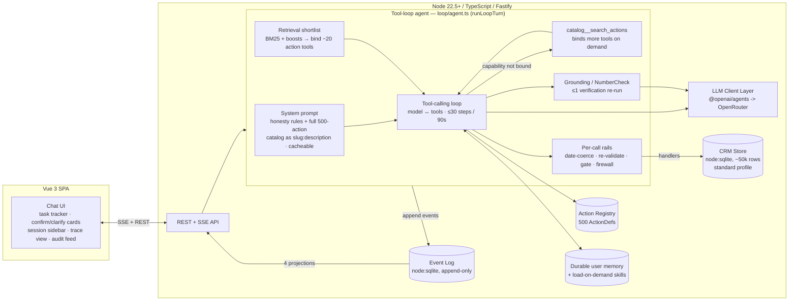

# Ask AI

A natural-language "Ask AI" agent over a simulated business platform — 50 modules, 500
executable actions (`M01.A01`–`M50.A10`, catalog fixed by the assignment brief), chatted
with ChatGPT-style over persistent sessions. The agent reads direct, indirect, multi-step,
conditional, ambiguous, and follow-up requests; selects and sequences the right actions out
of 500; executes them against a seeded SQLite store; and reports grounded results — never
results the model made up.

The thesis that shapes every architectural choice here: **the LLM is an untrusted actor;
deterministic code owns execution.** The model calls tools, but it never touches the
database directly, never decides when a write needs human approval, never invents a record
id, and never gets credit for a result it didn't actually produce. The production agent is a
**tool-calling loop** (`server/src/loop/agent.ts`, `runLoopTurn`): the model sees the full
500-action catalog as "slug: description" lines in a cacheable system prompt, starts each
turn with a retrieval-selected shortlist of action tools bound, and binds more on demand via
`catalog__search_actions` — then reads and writes by calling those tools, with every call
wrapped in deterministic rails (date coercion, schema re-validation, a confirmation gate, a
provenance firewall). This repo also carries the evidence for why that shape beats the
alternatives: a baseline ReAct agent and a retired plan-DSL pipeline that share the same
handlers and gates, a 60-query retrieval probe set, and a benchmark harness that computes
every published number from the same trace store the UI renders live.

## Demo video

A 2½-minute narrated walkthrough ships in the repo at
[`demo-out/ask-ai-demo.mp4`](demo-out/ask-ai-demo.mp4): the six request types from the brief
(direct, indirect, complex 3-module workflow, follow-up, ambiguity, honest failure) plus the
distinctive features — file **attachments** + rich tables/charts/record-popovers, **role-based
permissions**, and cross-session **memory**. It's composed from *real* app footage: Playwright
drives the live app and Remotion stitches the clips with Cartesia narration — see
[`video/README.md`](video/README.md) to reproduce.

## Quickstart

```bash
git clone <this-repo> && cd ask-ai
nvm use                      # pins Node 22.14.0 — node:sqlite requires >=22.5
npm install
cp .env.example .env         # then set OPENROUTER_API_KEY (see table below)
npm run seed                 # builds crm-standard.template.db (~50k rows, SHA-pinned)

# two terminals:
npm run dev                  # server (Fastify + SSE) on :3000
npm run dev:web              # Vue 3 + Vite on :5173, proxies /api -> :3000
```

Open `http://localhost:5173`. New chat → type a request → watch the task tracker stream
step cards, confirmation prompts, and the grounded final answer as the tool-loop runs.

### Environment variables (`.env.example`, committed)

| Variable | Meaning | Default / example |
|---|---|---|
| `OPENROUTER_API_KEY` | Your OpenRouter key. Required for any real (non-mock) LLM call. | *(empty — you must set it)* |
| `PLANNER_MODEL` | Default planner model, routed for non-trivial turns. | `anthropic/claude-haiku-4.5` |
| `FAST_MODEL` | Direct-path / simple-query model. | `google/gemini-2.5-flash-lite` |
| `PROFILE` | CRM seed profile to boot against. | `standard` (~50k rows) |
| `VIRTUAL_NOW` | Frozen virtual clock — handlers never call `Date.now()`. | `2026-11-04T10:00:00Z` |
| `EVAL_BUDGET_USD` | Hard process-wide spend ceiling for `npm run eval`. | `25` (matches `.env.example` and the code default in `server/src/llm/client.ts`; the `$8.50` figure in `docs/TARGETS.md` is the benchmark total-**spend** target, a separate thing) |
| `PORT` | Server port. | `3000` |
| `WEB_SEARCH_ENABLED` | Opt-in flag for the `web__search` tool — external public info via OpenRouter's native web plugin (reuses `OPENROUTER_API_KEY`, no separate account). The tool is bound only when on. | *(empty — off; `1`/`true`/`on`/`yes` enables)* |
| `WEB_SEARCH_MAX` | Max web-search results returned per query. | `5` |
| `WEB_SEARCH_MODEL` | Model used to run the web search. | *(empty → falls back to `FAST_MODEL`)* |
| `COMPOSER_POLISH` | Retired-pipeline only: one extra conversational-polish LLM call (`server/src/agent/composer.ts`); off for benchmarks. | `1` in `.env.example`; unset = off |
| `ASKAI_WORKSPACE_INSTRUCTIONS` | Org/admin steering text injected into the agent's system prompt (tone, fiscal calendar, naming/policy conventions). | *(empty)* |
| `SCHEDULER_POLL_MS` | Poll interval for firing due scheduled follow-ups/briefings; `0` disables the poller. | `30000` |
| `DEMO_USER_ID` | Acting-user id the single-tenant demo runs as — memory scoping and "me"/"my"/"I" resolution. | `user_1` |
| `PROVIDER_ORDER` | **Reserved — not yet wired** (no code reads it today): an intended OpenRouter provider pin to stop a flaky fallback route skewing latency/cost. | *(empty)* |

Without `OPENROUTER_API_KEY` the server still boots and the UI still renders, but every
model call fails — see `server/src/llm/mock-fetch.ts` and `MOCK_LLM_SCRIPT` for the
offline harness-verification path used by `eval/test/runner-e2e.test.ts` (excluded from all
benchmark numbers, see §Evaluation).

## Architecture



**The LLM-is-untrusted thesis, concretely:** the model's job is to call tools; it never
writes to the store directly. Every tool call passes through deterministic rails in
`loop/tools.ts` before a handler runs — placeholder filters are scrubbed, relative dates are
coerced, and the args are re-validated against the action's real strict Zod `inputSchema`; a
**provenance firewall** rejects any record id the model didn't actually see in a tool result
or the user's message (no guessed ids); and whether a write needs human confirmation is a
hard-coded predicate keyed on `risk` and resolved `affectedCount` (plus a value-based
policy for high-value/financial writes), never a model judgment call. If the model targets
an unbound or unknown tool the call is rescued (renamed or rerouted to catalog search),
never a dead turn.

**Capability coverage is the design's core trick.** Most tool-using agents can only call the
handful of tools bound to the turn, so a retrieval miss silently hides a capability. Here the
*full* 500-action catalog rides in the (cacheable) system prompt as "slug: description"
lines, so the model always knows every action that exists; retrieval only decides which
action *schemas* get bound as callable tools up front (~20 of 500), and the model binds any
other it needs on demand through `catalog__search_actions` (capped at 40 bound tools). A
bulk write over a large set is one `data__apply_to_ref` call, not N per-record calls, which
is what keeps a multi-record workflow inside the per-turn step budget (`MAX_LOOP_STEPS = 30`,
90s deadline — 180s on slow models).

### Primary request flow

```mermaid
sequenceDiagram
  participant U as User
  participant API as API/SSE
  participant AG as Tool-loop agent
  participant L as LLM (OpenRouter)
  participant S as CRM Store

  U->>API: POST message
  API->>AG: turn.started
  AG->>AG: fold(events) -> recent-turn memory; recall durable user memory
  AG->>AG: retrieve shortlist -> bind ~20 action tools (full catalog in system prompt)
  loop tool-calling loop (<=30 steps / 90s)
    AG->>L: model call (tools + context)
    L-->>AG: tool call(s) or final answer
    opt capability not yet bound
      AG->>AG: catalog__search_actions -> bind more tools
    end
    opt destructive / bulk / external / high-value write
      AG-->>U: SSE confirmation.required (plan-hash bound)
      U->>API: confirm / deny
    end
    AG->>S: read/write via handler (rails: date-coerce -> re-validate -> firewall -> crm.tx)
    AG-->>U: SSE step.started / step.finished
  end
  opt zero-read data answer or unsupported figures
    AG->>L: one grounding / NumberCheck re-run
  end
  AG-->>U: SSE answer.delta (streamed) + answer.final
  AG-->>U: SSE turn.completed {latency, tokens, cost}
```

## The 500-action catalog

Fifty module files (`server/src/catalog/m01-contacts.ts` … `m50-reports.ts`), each exporting
exactly 10 `ActionDef`s. Dropping a new module file into `src/catalog/` and adding it to
`registry.ts`'s load list is the entire registration step — no other core file changes.
Every action looks like this (`m01-contacts.ts` is the reference implementation every other
module's handler copies verbatim):

```ts
interface ActionDef<I, O> {
  id: string;            // "M01.A01"
  slug: string;           // "contacts.create_contact" — what the planner emits
  module: string; name: string; description: string;
  risk: 'read' | 'write' | 'destructive' | 'bulk' | 'external';
  entities: string[];
  inputSchema: z.ZodType<I>;      // strict — extra fields rejected
  outputSchema: z.ZodType<O>;
  searchCard: { synonyms: string[]; examplePhrasings: string[]; disambiguation?: string };
  jit?: string;           // <=120-token guidance appended inside successful results
  handler: (input: I, ctx: ActionContext) => Promise<O>;
}
```

`risk` drives the confirmation gate (below); `searchCard` is the only thing retrieval ever
sees — synonyms and example phrasings are hand-authored, not generated, because they're what
makes fuzzy/typo'd requests findable. Outputs are disciplined: every record carries `id` AND
a display name (no bare-id answers the user can't parse), list outputs cap at 50 inline rows
and spill to `{ref, total, sample}` beyond that, and `jit` guidance rides *inside* a
successful result rather than bloating the system prompt for every module whether or not
it's relevant this turn.

All 500 handlers are real: they validate input against the strict Zod schema, mutate a
seeded `node:sqlite` store inside a transaction, enforce idempotency via
`${turnId}:${planRev}:${stepId}:${itemIndex}` keys, and raise typed errors (`NOT_FOUND`,
`CONFLICT`, `VALIDATION`, `TRANSIENT`, `FORBIDDEN`, `LIMIT_EXCEEDED`) — not canned success.
`npm run smoke` auto-enumerates and invokes every one of the 500 with minimal valid input;
~120 scenario-exercised and all destructive/bulk/external actions additionally get a
filter-discrimination check (two different filter values must yield different result counts
— the #1 codegen bug class for 500 hand-reviewed handlers) and a write-then-read round-trip.

## Tool selection

No embeddings, no LLM router, no learned ranking. Retrieval is deterministic:

```
score(action) = 0.70·bm25(query, actionCard) + 0.20·sessionUsageBoost + 0.10·moduleCohesionBoost
```

`minisearch` with `fuzzy: 0.2` and prefix matching (typos are a named brief requirement,
tested explicitly — see `typo-*` scenarios), diversified to at most 4 actions per module, top
~20 cards rendered as plain text inside the user message. The system prompt and meta-tool
definitions stay byte-stable across turns so the prompt prefix is cache-eligible regardless
of which 20 of 500 actions get shortlisted that turn.

**Why not embeddings or an LLM router, when everyone defaults to one of those:** two
convergent pieces of evidence say lexical-plus-graph is sufficient at this catalog size.
goose (Block's open-source agent) shipped and then deleted both an embedding-based tool
router and an LLM-based one, settling back on lexical matching. Anthropic's own newest
tool-search tooling is BM25-based, not embedding-based. On top of that, we author the search
cards ourselves — synonyms and example phrasings are hand-written per action, which is
exactly the lever that makes lexical matching work well; it's a much smaller investment than
training or maintaining an embedding index for a catalog this size. The recall gate
(`eval/probes/retrieval.yaml`, 60 queries, ≥12 typo + ≥20 paraphrase) requires recall@20 ≥
0.95 before this is trusted; an embedding reranker behind a stubbed interface is the
documented contingency if a future probe set ever fails that bar. A PPR (personalized
PageRank) action-graph cut was evaluated and deferred for the same reason: intellectually
appealing, not rubric-moving once the lexical probe set already clears the bar — see
`docs/design/LLD.md` §4 for the full note.

## Context & memory

Working memory is a small typed object re-injected every turn, not the raw transcript:

- **One active task frame** (`{intent, status, filters, missingParams}`) — topic switches
  replace it; a task-frame *stack* was designed and cut (suspend/resume was undemonstrable
  in the time available, so completed frames fold into a one-line entity-provenance note
  instead of a real suspend/resume stack).
- **Entity map** — "the Facebook campaign" → `{id, type, name, source, turn}` with
  provenance, so a later turn's write resolves the *id*, never re-parses the name out of
  transcript prose.
- **Result handles (`$ref`s)** — large result sets never round-trip through the model.
  A handle carries `{ref, total, idList (≤10k), query descriptor, sample (20 rows)}`; "make
  those 200 due tomorrow" resolves the 200 ids server-side, never by asking the model to
  restate them. Cross-turn refs are the planner's `$r_t<T>_s<N>` form, rendered into the
  prompt as `$r_t3_s1 (200 leads — leads.search_leads, turn 3)`.
- **Use-time existence re-check, not a frozen snapshot** — a stale ref's ids are
  re-validated against the store when it's actually used; drift is reported ("14 of 200 no
  longer match — proceeding with 186"), not silently hidden, and >25% drift on a gated step
  forces re-confirmation.
- **Observation masking** — the last ~3 turns' tool results are kept verbatim in the
  transcript; older ones collapse to one-line placeholders. No LLM-summarized memory: a
  JetBrains finding (cited in `docs/superpowers/specs/2026-11-03-ask-ai-framework-design.md`)
  found masking beats summarization at roughly half the cost and summarization reliably
  breaks prompt caching on every turn it reruns.
- **The hallucination firewall** — the hard invariant across all of this: the executor
  resolves every `$ref`/entity id from working-state handles or step results, server-side,
  never from a literal id the model typed into a param when a ref existed instead. The
  validator additionally rejects a ref-shaped literal that was fabricated rather than
  resolved through a search step.

## Execution strategy

The turn is a **tool-calling loop** (`server/src/loop/agent.ts`, `runLoopTurn`), not a
plan-then-execute pipeline. Each iteration the model either calls tools or emits the final
answer; the loop is bounded by `MAX_LOOP_STEPS = 30` and a wall-clock deadline (90s fast
tier, 180s for slow models), with a per-model-call timeout so one hung provider call cannot
eat the whole budget.

1. **Bind** — an initial retrieval shortlist binds ~20 of the 500 actions as native tools;
   the full catalog is listed in the system prompt so nothing is hidden. Permission pruning
   means a restricted principal is never given a tool — or even told about an action — it may
   not use. Actions already used earlier in the session, and the whole `workflows` /
   `event_triggers` modules on automation intent, are force-bound so a workflow can be built
   in order.
2. **Call** — the model calls a tool. Before any handler runs, the `execute` wrapper in
   `loop/tools.ts` scrubs placeholder filters (`*`/`all`/empty), coerces relative dates,
   re-validates the args against the action's original strict Zod schema, and runs the
   **provenance firewall**: an id-targeting call (reads included) may only use ids the model
   has already seen in a result or the user's message — a guessed id is blocked, not written.
   A call to an unbound/unknown tool is rescued, not dropped.
3. **Gate** — a write confirms iff `risk ∈ {destructive, bulk, external}`, OR
   `affectedCount > 50`, OR it is a record *mutation* (not a plain create), OR a value-based
   policy fires (financial / high-value writes). Confirmations are bound to
   `planHash + stepId`; a denial is final for that action+target the rest of the turn, a
   snapshot-and-recheck refuses a write whose targets changed between proposal and approval,
   and an approval-time edit may change values but never retarget the write. One confirmation
   covers a whole bulk batch; per-record idempotency keys make a re-run safe.
4. **Discover** — if no bound tool fits, the model calls `catalog__search_actions`, which
   binds the matching actions as callable tools on the next step (langgraph-bigtool /
   Anthropic Tool-Search pattern: discovery leads to invocation, never a dead end), capped at
   `MAX_BOUND_TOOLS = 40`. A `StuckTracker` injects a corrective hint on the 3rd identical
   failed call and stops the loop on the 4th.
5. **Ground** — the model writes the final answer, but it is not trusted blind. A
   deterministic `NumberCheck` verifies every figure/date against this turn's tool outputs; a
   zero-read answer to a live-data question forces ONE grounding re-run (with
   `toolChoice: 'required'`); and belt-and-suspenders disclosures append honest cautions for
   unsupported figures, unsanctioned filters, partial coverage, or count mismatches. Cited
   record ids resolve to named chips.

**Honest exits** — `session__ask_user` (clarify), `session__refuse` (unsupported), and
`session__request_form` (gather several values at once) are first-class tools; a plain-text
question on a no-write turn is also reclassified to `clarify`. Bulk fan-out beyond
`APPLY_MAX_RECORDS = 1000` (200 for destructive bulk) is refused outright — "narrow the
selection" — never silently chunked.

**Retired plan-DSL comparator** (`server/src/agent/pipeline.ts`, `plandsl`): the original
plan → validate → execute → join → compose pipeline — the planner emitted a typed `Plan` via
`generateObject`, the validator compiled it against a `$ref` grammar, a stratum scheduler ran
gated writes, and a code-only joiner compared results against each step's `expects` before
composing a templated answer. It is kept callable only as a benchmark comparator (reachable
via a raw API `agent: 'plandsl'` param, never the default). Its one genuinely reusable
war-story: the Plan DSL that `executor.ts`/`validator.ts` consumed internally was a clean
discriminated union, but the schema sent to `generateObject` had to be flattened (`params` as
a JSON-encoded *string*, always-present sentinel fields) because Anthropic, OpenAI, and
Gemini's strict structured-output modes each reject a different shape of the natural
nested-union schema — see `docs/SPIKES.md` §1. The tool-loop sidesteps that entire class of
problem by handing each action its own native tool schema instead of one mega-plan schema.

## What's real vs mocked

| | Real | Mocked / simulated |
|---|---|---|
| Tool-loop agent | Retrieval shortlist, full-catalog awareness, tool calls, per-call rails (date coercion, schema re-validation, confirmation gate, provenance firewall), grounding / NumberCheck — all real code, no hardcoded prompt→answer mappings | — |
| LLM calls | Real OpenRouter calls (Claude Haiku 4.5, Gemini 2.5 Flash Lite, GPT-5-mini) with real per-request cost/token accounting via `usage:{include:true}` | — |
| Web search | Real OpenRouter native web-plugin calls when `WEB_SEARCH_ENABLED=1` — real external URLs + citations fed back as untrusted reference context | Off by default; it is external web content, never treated as CRM data, and never a source of record ids |
| Store state machine | Every handler mutates a real `node:sqlite` database inside a transaction; failures are real typed errors, not scripted | CRM *data* is synthetic — deterministically seeded (~50k rows, fixed seed, committed template, SHA-pinned), not a real CRM tenant |
| Evals | Real HTTP calls against a real running server, real state-based assertions (SQL queries against the actual post-turn database), real trace store | — |
| Sends (email/SMS) | Real handler execution, real state mutation, real message records created | The external delivery itself is simulated — `email.send_email`'s own `jit` text says it plainly: "simulated external send." No message leaves the process. |
| Integrations | — | No real third-party CRM API, no auth/multi-tenancy, no payment processor, no calendar provider — explicitly out of scope per the brief |
| Confirmation gates | Real code-enforced predicate, real pause/resume via the event log | — |

The honest line: everything *between* "user types a message" and "a row changed in a real
database, with a real cost logged" is real. The thing that's fake is the world the database
represents.

## Evaluation & reproduction

Targets were pre-committed in `docs/TARGETS.md` **before** any benchmark run — the report
renders those exact numbers next to what was actually measured with a MET/MISSED column,
and the targets file is never edited after a run starts except with an explicit, disclosed
reason (its own changelog records the one legitimate pre-run clarification that happened).

**Scenario format** (`eval/scenarios/*.yaml`, ≥110 across all 8 request categories + typo/
abstention/distractor/no-repeat subtypes, every module touched ≥2×):

```yaml
id: followup-invoices-cancel-first
category: followup
profile: standard
turns:
  - user: "Show me contact con_247's unpaid invoices."
    expect:
      planActions: { mustInclude: [invoices.search_invoices] }
      state: [{ query: "SELECT COUNT(*) ... status='issued'", equals: 2 }]
      behavior: { confirmation: false }
  - user: "Actually, go ahead and cancel the first one — that deal's off."
    expect:
      planActions: { mustInclude: [invoices.void_unpaid_invoice] }
      state: [{ query: "SELECT COUNT(*) ... status='void'", gte: 1 }]
      behavior: { confirmation: true }
      response: { mustNotClaim: [failed, error] }
```

Assertions are state-based (`equals`/`gte`/`countDelta` against a real SQL query on the
post-turn database), not response-text pattern matching — a scenario passes because the data
actually changed the right way, not because the reply sounded right. `gte`/`countDelta` are
preferred over brittle absolute counts for plan-dependent (open-ended "how many did you
decide to act on") outcomes.

**Commands:**

```bash
npm run smoke            # all 500 handlers, minimal-valid-input invocation
npm run probe            # retrieval recall@20 against the 60-query probe set
npm run eval:quick       # stratified 20-scenario x 1 trial — the fast inner debug loop
npm run eval             # full corpus x 3 trials (optimized) + baseline, cost-ceiling guarded
npm run eval:baseline    # ReAct baseline only
npm run benchmark:report # renders docs/BENCHMARK.md from the trace/results store
```

**Determinism:** `VIRTUAL_NOW` is pinned (never real wall-clock "today" — scenarios hardcode
dates); `POST /admin/reset` does close-handle → copy-committed-template → reopen (<300ms,
single mechanism, no rollback path) so every scenario starts from byte-identical data; the
template DB is committed to the repo precisely so determinism is the artifact's property,
not the generator's.

**Trials & the pass^1 vs pass^3 distinction:** the optimized agent runs 3 trials per
scenario; the baseline runs 1 (disclosed, not hidden — see Trade-offs below for why). τ-bench
found pass^1 61% can hide pass^8 under 25% — a single successful run tells you almost nothing
about reliability. Both numbers are reported per category.

**$-budget guard:** `EVAL_BUDGET_USD` is a hard process-wide ceiling enforced inside the
runner itself; a run that would exceed it aborts and reports a partial table rather than a
padded or extrapolated one. The project's actual available credit turned out to be $10, not
the originally planned $25 — the budget split was renegotiated accordingly and disclosed in
`docs/TARGETS.md`'s changelog: optimized gets the full corpus × 3 trials, baseline the full
corpus × 1 trial (the full-catalog ReAct prompt is ~12k tokens/step, so the baseline is held
to a single trial rather than the optimized agent's 3), and the model-matrix spot check
(Haiku 4.5 / GPT-5-mini-minimal / Gemini 2.5 Flash) runs only if residual budget permits,
capped at ≤10 scenarios.

## Results

**Optimized 70.9% pass¹ vs baseline 51.7% (+19.2pp); the optimized tool-loop + retrieval-shortlist design costs \$0.0394 per successful task vs the baseline's \$0.0978 (~60% lower) and brings complex-latency targets within bound; pass-rate and direct-p95 remain short.** — see `docs/BENCHMARK.md` for the full report, regenerated from the trace store.
the headline rows from the same trace store the UI's trace view renders live.

| Metric | Target | Optimized | Baseline | Met? |
|---|---|---|---|---|
| Direct TTFUR, p50 | < 2s | `2004ms` | `2211ms` | `MISSED (≈target)` |
| Direct TTFUR, p95 | < 4s | `7001ms` | `4790ms` | `MISSED` |
| Complex TTFUR, p50 | < 4s | `2073ms` | — | `MET` |
| Complex E2E, p50 | < 12s | `7992ms` | `7926ms` | `MET` |
| Complex E2E, p95 | < 25s | `19440ms` | — | `MET` |
| Task success, pass^1 | ≥ 85% | `70.9%` | `51.7%` | `MISSED` |
| Task success, pass^3 | reported alongside pass^1 | `63.6% (all-3-consistent)` | n/a (1 trial) | — |
| Optimized vs baseline delta | ≥ +15pp | `+19.2pp` | — | `MET` |
| Cost / successful task (strict) | < $0.01 | `$0.0394` | `$0.0978` | `MISSED (−60% vs baseline)` |
| Repair-rate, complex (assumption) | < 35% | `0.0%` | — | `MET` |
| Total benchmark spend | ≤ $8.50 | `$12.84 (non-cached pricing)` | — | `MISSED` |

### Honest misses

Six scenarios were triaged as genuine capability gaps, not scenario or harness defects, and
are reported as known misses rather than quietly excluded or papered over with a looser
assertion:

- **`conditional-contacts-001`** — a 3-way anti-join (no appointment AND no task AND no open
  opportunity since a fuzzy date) combined with a `destructive`-risk gate. The planner
  returns `clarify` after exhausting a search round rather than reaching a plan at all;
  composition depth, not date-fuzziness, is the limiting factor (simpler single-condition
  siblings in the same category pass).
- **`followup-appointments-no-repeat`** — a plain read ("what meetings do I have between the
  10th and the 14th") triggers a clarify on turn 0 despite an unambiguous nearest-month
  reading against the pinned virtual clock. Planner over-caution on a zero-risk read, not a
  code defect.
- **`followup-appointments-note`** — cross-turn positional anaphora ("add a note on the
  contact from the first one") into a prior turn's `$r_t<T>_s<N>` handle. The grammar
  supports this form; the planner doesn't reliably reach for it.
- **`indirect-invoices-001`** — stops at a diagnostic read (`search_invoices`) instead of
  completing the recognize-problem → list-overdue → send-reminder remedy chain the "indirect"
  category is designed to test, and reports `done` rather than noticing the gap.
- **`multistep-communities-001`** — `create_discussion_channel`'s output is the whole parent
  community view, not the created channel; extracting "the channel I just created" needs an
  extra `core.filter`/`core.pluck` step the planner doesn't reliably insert, so a direct
  `$s2.id` reference resolves to the wrong entity and the write throws `NOT_FOUND`.
- **`indirect-conversations-001`** — stabilized across two fix rounds (the cross-module
  hallucination `support_tickets.reply_to_ticket_requester` is gone), but the planner now
  drops the remedy step entirely rather than following its own fallback guidance
  (`tasks.create_task`), ending `done` on a read-only plan.

**Variance finding (quick-run triage, `TRIAGE-quick2.md`):** re-running the same 20-scenario
sample after an unrelated fix batch flipped 3 of 20 outcomes (15%) purely from first-call
sampling noise at `clarify`/`search`/`unsupported` decision boundaries — none of the
intervening commits touch that routing logic. A further 2 of 20 flickered their terminal
status label (`clarify`↔`refused`) without changing pass/fail. Direct/abstention scenarios
with fully-specified, unambiguous inputs showed zero drift in the same sample. This is the
concrete justification for reporting pass^3 rather than trusting a single pass^1 run as a
regression signal.

**Cache-absent finding (`docs/SPIKES.md` §2, §2a):** explicit Anthropic prompt caching
(`cacheControl: {type:'ephemeral'}`) was spiked twice — once at the planner's real ~1.17k-
token system prompt size (inconclusive: below Anthropic's ~2,048-token cache-eligibility
floor) and once padded to ~3.2k tokens (unambiguously past the floor). Both times: zero
cached tokens, identical cost between an identical back-to-back call pair. Confirmed absent,
not just unverified — every cost estimate in this project uses non-cached input pricing, and
the baseline-economics budget split assumes no caching discount anywhere.

## Trade-offs

**Latency.** The brief's own framing ("loading indicators don't count") is why TTFUR — time
to first *useful* response, not a spinner — is the metric. The loop marks TTFUR at the first
streamed answer token, or, when a turn's first useful act is a destructive/bulk confirmation,
at the `confirmation.required` event — because no single definition is honest across outcome
kinds (`docs/TARGETS.md` §3). A turn that needed extra tool-calling rounds genuinely took
longer to become useful, and that latency is counted, not hidden inside a "the model is
thinking" indicator. "Complex" turns are bucketed by dispatched-action count (>1), not by any
plan structure.

**Cost.** The retrieval shortlist (~20 of 500 action schemas) versus the baseline's full
500-action catalog resent on every single ReAct step is the entire cost story in one
sentence — the baseline's own system prompt is ~12k tokens *per step*, repeated `stepCountIs`
times, specifically because that repetition is what the comparison needs to isolate (LLD §8:
"that's the point of the baseline"). Spill-to-ref plus the ref-tools mean a large result set
never round-trips through the model, so output tokens stay low (431 avg) regardless of
result-set size. The $10 total project credit (not the originally planned $25) is the
real-world constraint that held the baseline to 1 trial (vs the optimized agent's 3) — rather
than a padded per-scenario budget — disclosed, not hidden, in `docs/TARGETS.md`'s changelog.

**Quality.** Correct *selection* comes from putting the full 500-action catalog in the prompt
(no retrieval miss can hide a capability) over a retrieval-ranked shortlist of bound tools;
correct *execution* comes from the per-call rails — strict Zod re-validation, the provenance
firewall (no model-invented ids), and a NumberCheck grounding re-run that refuses figures not
present in tool output. Reported as pass^1 *and* pass^3 per category because a single
successful trial is close to
meaningless for reliability claims at this complexity — τ-bench's own finding (pass^1 61% /
pass^8 <25%) is the citation, and this project's own 15–25% single-call variance on
ambiguous/conditional/followup/multistep categories (measured directly, see Results above)
confirms the same pattern at smaller scale.

## Limitations & scaling beyond 500 actions

**Not production-ready, by design, and that's a line this README draws rather than blurs:**
mocked CRM data, no auth or multi-tenancy, single process with no failover/queue/concurrency
testing, baseline-only security hardening, no model-ops layer (no provider failover tested
under load, no canary rollout for a model swap).

**What already *is* production-shaped** (a genuine claim, not a hedge): event-sourced
sessions (state = `fold(events)`, replay and live render share one code path), idempotency
keys on every write, persist-before-ack, code-enforced plan-hash-bound confirmation gates
(never a model's self-report), span-level cost/latency observability with zero external APM
dependency, and a CI-runnable eval suite that computes benchmark numbers from the same store
the demo shows — the "regression flywheel" pattern production agent teams (Sierra, Decagon)
actually run on.

**Path to production**, each a swap rather than a rewrite: CRM store → real APIs/Postgres;
session SQLite → Postgres; authn + role-scoped action visibility (the deny path is "the
schema for that action is never sent to the planner," not a runtime permission check after
the fact); single process → a turn queue with stateless workers that fold state from events;
pinned single provider → cross-provider failover; the eval suite → a CI regression gate that
blocks a merge, not just a demo artifact.

**Deferred designs, each with its rationale:**

- **PPR (personalized PageRank) action graph** — an offline graph over shared entity types
  and output-feeds-input edges, scored and blended into retrieval. Evaluated, not built: the
  60-query recall@20 probe already clears 0.95 with lexical-plus-boost scoring alone, so the
  added complexity bought nothing measurable against the rubric. Documented here rather than
  silently dropped so a future catalog growth (past 500 actions, where lexical alone may
  start missing) has a concrete next step instead of a blank page.
- **Research sub-run** — a read-only, isolated sub-agent invocation with a structured report
  contract, for turns that need broad exploratory reading before committing to a plan.
  README-only by explicit choice: Anthropic's own published multi-agent research found
  roughly 15× the token cost of a single-agent pass, and this project's CRM writes have
  cross-step dependencies that a sub-agent's isolated context would need to re-discover
  anyway. Zero build time spent; the design is documented, not implemented.
- **10M-row scale profile** — the `standard` profile (~50k rows) is committed and used for
  every eval/demo; a `scale` profile (500k–1M rows) is designed, not yet scripted (same
  generator shape as `scripts/seed-standard.ts`, different row counts) to demonstrate
  ref-handle latency staying flat versus data volume. A 10M-row profile is likewise designed
  (documented, not run) but intentionally never built — it was never on the critical path for
  a 5-day, benchmark-rigor-prioritized build, and running it would have consumed eval budget
  that mattered more spent on the real scenario corpus.
- **Task-frame stack (suspend/resume across topics)** — cut from the LLD after staff review:
  a single active frame plus one-line provenance for completed frames covers every follow-up
  pattern actually tested; a real suspend/resume stack was judged undemonstrable in the time
  available and was removed rather than shipped half-verified.

## Repo tour

| Path | What's there |
|---|---|
| `server/src/catalog/` | 50 module files (`m01-contacts.ts` … `m50-reports.ts`), each 10 `ActionDef`s + `registry.ts` auto-loader + shared helpers (`idempotency.ts`, `list-output.ts`, `discrimination.ts`, `core-ops.ts` for the DSL's built-in data ops) |
| `server/src/entities/` | Entity data model (~26 merged tables), DDL, deterministic seed generators |
| `server/src/store/` | `node:sqlite` access layer, virtual clock, template-copy reset |
| `server/src/loop/` | **The production agent** — `agent.ts` (`runLoopTurn`: the tool-calling loop, grounding/NumberCheck, honest exits, step + wall-clock budgets), `tools.ts` (per-turn native tool construction + all write rails: date coercion, re-validation, confirmation gate, provenance firewall, bulk `apply_to_ref`), `prompts.ts` (byte-stable system prompt + full 500-action catalog listing), plus `date-rail.ts`, `recent-turns.ts`, `web-search.ts`, `number-check.ts`, `scope-check.ts`/`coverage-check.ts`/`count-reconcile.ts`, `tool-call-rescue.ts`, and load-on-demand `skills/` |
| `server/src/memory/` | Durable cross-conversation user memory — `store.ts`, `extract.ts` (post-turn background extractor), `render.ts`, `denylist.ts` (secret/volatile screening) |
| `server/src/agent/` | **Retired plan-DSL comparator** (`pipeline.ts`, `planner.ts`/`plan-schema.ts`/`validator.ts`, `executor.ts`, `joiner.ts`, `composer.ts`) **plus shared primitives the loop reuses**: `retrieval.ts`, `refs.ts`, `permissions.ts`, `approval-policy.ts`, `scheduled-tasks.ts`, `workflow-engine.ts`, `date-expr.ts`, and `executor.ts`'s `shouldGate`/`ConfirmBroker` |
| `server/src/playbooks/` | 3 SKILL.md-format procedures (`lead-follow-up-sweep`, `overdue-invoice-reminders`, `pipeline-review`) + loader |
| `server/src/llm/` | AI SDK wrapper, cost/usage logger, model router, exponential backoff, budget guard |
| `server/src/events/` | Event types, append-only log, 4 projections (SSE / trace / metrics / audit) |
| `server/src/api/` | Fastify routes — sessions, SSE streaming, confirm/cancel, admin reset, metrics, traces |
| `server/src/baseline/` | The ReAct comparator agent — summarized full catalog + one `call_action` dispatch tool |
| `web/src/` | Vue 3 + Pinia chat UI — `ChatView`, `TaskTracker`, `ConfirmCard`/`ClarifyCard`, `Sidebar`, `TraceView`, `AuditFeed`, `CostBadge` |
| `eval/` | `scenarios/*.yaml` (≥110), `runner.ts`, `assert.ts`, `report.ts`, `smoke.ts`, `probes/retrieval.yaml` |
| `docs/design/` | `HLD.md` (architecture + decisions), `LLD.md` (build contract — canonical for field names) |
| `docs/TARGETS.md` | Pre-committed benchmark targets, never edited after a run starts |
| `docs/SPIKES.md` | Day-1 go/no-go spikes — schema cross-provider compatibility, prompt-cache verification |
| `docs/BENCHMARK.md` | Final benchmark report, rendered by `npm run benchmark:report` |
| `docs/DEMO-SCRIPT.md` | Timed script for the 6-item demo recording |
| `scripts/` | `seed-standard.ts`, `transcribe-catalog.ts`, `probe.ts`, spike scripts |
