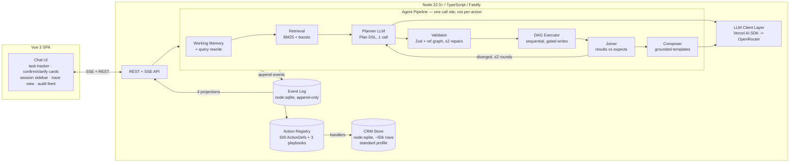

# Ask AI

A natural-language "Ask AI" agent over a simulated business platform — 50 modules, 500
executable actions (`M01.A01`–`M50.A10`, catalog fixed by the assignment brief), chatted
with ChatGPT-style over persistent sessions. The agent reads direct, indirect, multi-step,
conditional, ambiguous, and follow-up requests; selects and sequences the right actions out
of 500; executes them against a seeded SQLite store; and reports grounded results — never
results the model made up.

The thesis that shapes every architectural choice here: **the LLM is an untrusted planner;
deterministic code owns execution.** The model emits a typed plan, never touches the
database directly, never decides when a write needs human approval, and never gets credit
for a result it didn't actually produce. The agentic loop runs at *phase* granularity
(plan → validate → execute → observe → replan), not per-action — a direct request costs one
LLM call, a nine-step workflow costs one to three, regardless of how many of the 500 actions
it touches. This repo also carries the evidence for why that shape beats the alternatives:
a baseline ReAct agent sharing the same handlers and gates, a 60-query retrieval probe set,
and a benchmark harness that computes every published number from the same trace store the
UI renders live.

## Quickstart

```bash
git clone <this-repo> && cd ask-ai
nvm use                      # pins Node 22.14.0 — node:sqlite requires >=22.5
npm install
cp .env.example .env         # then set OPENROUTER_API_KEY (see table below)
npm run seed                 # builds crm-standard.template.db (~50k rows, SHA-pinned)

# two terminals:
npm run dev                  # server (Fastify + SSE) on :3000
npm run dev:web              # Vue 3 + Vite on :5173, proxies /api -> :3000
```

Open `http://localhost:5173`. New chat → type a request → watch the task tracker stream
`plan.ready`, step cards, confirmation prompts, and the grounded final answer.

### Environment variables (`.env.example`, committed)

| Variable | Meaning | Default / example |
|---|---|---|
| `OPENROUTER_API_KEY` | Your OpenRouter key. Required for any real (non-mock) LLM call. | *(empty — you must set it)* |
| `PLANNER_MODEL` | Default planner model, routed for non-trivial turns. | `anthropic/claude-haiku-4.5` |
| `FAST_MODEL` | Direct-path / simple-query model. | `google/gemini-2.5-flash-lite` |
| `PROFILE` | CRM seed profile to boot against. | `standard` (~50k rows) |
| `VIRTUAL_NOW` | Frozen virtual clock — handlers never call `Date.now()`. | `2026-11-04T10:00:00Z` |
| `EVAL_BUDGET_USD` | Hard process-wide spend ceiling for `npm run eval`. | `8.50` (project's actual credit-constrained ceiling) |
| `PORT` | Server port. | `3000` |
| `PROVIDER_ORDER` | Optional OpenRouter provider pin (e.g. avoid a flaky fallback route skewing latency/cost). | *(empty)* |

Without `OPENROUTER_API_KEY` the server still boots and the UI still renders, but every
planner/joiner call fails — see `server/src/llm/mock-fetch.ts` and `MOCK_LLM_SCRIPT` for the
offline harness-verification path used by `eval/test/runner-e2e.test.ts` (excluded from all
benchmark numbers, see §Evaluation).

## Architecture



**The LLM-is-an-untrusted-planner thesis, concretely:** the planner's one job is to emit a
typed `Plan` (or `clarify`/`unsupported`/`respond`/`search`). It never writes to the store,
never resolves which rows a bulk action touches (the executor resolves `$ref`s server-side,
never from model-echoed literal ID lists), and never decides whether a write needs human
confirmation — that's a hard-coded predicate in `executor.ts` keyed on `risk` and resolved
`affectedCount`, not a model judgment call. If the model hallucinates a step the validator
rejects it; if a repaired plan still doesn't parse, the turn fails loudly rather than
executing something unvalidated.

**Loop granularity is the latency/cost story.** Most agent frameworks loop per tool call —
retrieve-think-act-observe for every one of N actions in a workflow. Here the loop is at the
*phase* boundary: one planner call produces the whole DAG, the executor runs every
independent step without going back to the model, and the joiner (not another full replan)
handles the common "my assumption about the data was wrong" case with a single targeted
repair call. A 9-step plan (the brief's own flagship "assign & follow up with unreplied
leads" workflow — see `server/test/plan-schema.test.ts`) costs the same 1 LLM call as a
1-step one, until something actually needs correcting.

### Primary request flow

```mermaid
sequenceDiagram
  participant U as User
  participant API as API/SSE
  participant AG as Agent
  participant L as LLM (OpenRouter)
  participant S as CRM Store

  U->>API: POST message
  API->>AG: turn.started
  AG->>AG: fold(events) -> working memory; rewrite query
  AG->>AG: retrieve top-20 action cards (+ playbook match)
  AG->>L: plan (generateObject, 1 call)
  L-->>AG: Plan DSL
  AG-->>U: SSE plan.ready  <-- FIRST USEFUL RESPONSE (TTFUR)
  AG->>S: read steps (sequential, indexed)
  AG->>AG: joiner checks results vs expects
  opt diverged (<=2 rounds)
    AG->>L: patch plan
  end
  opt destructive/bulk/external step
    AG-->>U: SSE confirmation.required (plan-hash bound)
    U->>API: confirm
  end
  AG->>S: write steps (sequential, idempotency keys)
  AG-->>U: SSE step.finished x N
  AG-->>U: SSE answer.delta (streamed composer)
  AG-->>U: SSE turn.completed {latency, tokens, cost}
```

## The 500-action catalog

Fifty module files (`server/src/catalog/m01-contacts.ts` … `m50-reports.ts`), each exporting
exactly 10 `ActionDef`s. Dropping a new module file into `src/catalog/` and adding it to
`registry.ts`'s load list is the entire registration step — no other core file changes.
Every action looks like this (`m01-contacts.ts` is the reference implementation every other
module's handler copies verbatim):

```ts
interface ActionDef<I, O> {
  id: string;            // "M01.A01"
  slug: string;           // "contacts.create_contact" — what the planner emits
  module: string; name: string; description: string;
  risk: 'read' | 'write' | 'destructive' | 'bulk' | 'external';
  entities: string[];
  inputSchema: z.ZodType<I>;      // strict — extra fields rejected
  outputSchema: z.ZodType<O>;
  searchCard: { synonyms: string[]; examplePhrasings: string[]; disambiguation?: string };
  jit?: string;           // <=120-token guidance appended inside successful results
  handler: (input: I, ctx: ActionContext) => Promise<O>;
}
```

`risk` drives the confirmation gate (below); `searchCard` is the only thing retrieval ever
sees — synonyms and example phrasings are hand-authored, not generated, because they're what
makes fuzzy/typo'd requests findable. Outputs are disciplined: every record carries `id` AND
a display name (no bare-id answers the user can't parse), list outputs cap at 50 inline rows
and spill to `{ref, total, sample}` beyond that, and `jit` guidance rides *inside* a
successful result rather than bloating the system prompt for every module whether or not
it's relevant this turn.

All 500 handlers are real: they validate input against the strict Zod schema, mutate a
seeded `node:sqlite` store inside a transaction, enforce idempotency via
`${turnId}:${planRev}:${stepId}:${itemIndex}` keys, and raise typed errors (`NOT_FOUND`,
`CONFLICT`, `VALIDATION`, `TRANSIENT`, `FORBIDDEN`, `LIMIT_EXCEEDED`) — not canned success.
`npm run smoke` auto-enumerates and invokes every one of the 500 with minimal valid input;
~120 scenario-exercised and all destructive/bulk/external actions additionally get a
filter-discrimination check (two different filter values must yield different result counts
— the #1 codegen bug class for 500 hand-reviewed handlers) and a write-then-read round-trip.

## Tool selection

No embeddings, no LLM router, no learned ranking. Retrieval is deterministic:

```
score(action) = 0.70·bm25(query, actionCard) + 0.20·sessionUsageBoost + 0.10·moduleCohesionBoost
```

`minisearch` with `fuzzy: 0.2` and prefix matching (typos are a named brief requirement,
tested explicitly — see `typo-*` scenarios), diversified to at most 4 actions per module, top
~20 cards rendered as plain text inside the user message. The system prompt and meta-tool
definitions stay byte-stable across turns so the prompt prefix is cache-eligible regardless
of which 20 of 500 actions get shortlisted that turn.

**Why not embeddings or an LLM router, when everyone defaults to one of those:** two
convergent pieces of evidence say lexical-plus-graph is sufficient at this catalog size.
goose (Block's open-source agent) shipped and then deleted both an embedding-based tool
router and an LLM-based one, settling back on lexical matching. Anthropic's own newest
tool-search tooling is BM25-based, not embedding-based. On top of that, we author the search
cards ourselves — synonyms and example phrasings are hand-written per action, which is
exactly the lever that makes lexical matching work well; it's a much smaller investment than
training or maintaining an embedding index for a catalog this size. The recall gate
(`eval/probes/retrieval.yaml`, 60 queries, ≥12 typo + ≥20 paraphrase) requires recall@20 ≥
0.95 before this is trusted; an embedding reranker behind a stubbed interface is the
documented contingency if a future probe set ever fails that bar. A PPR (personalized
PageRank) action-graph cut was evaluated and deferred for the same reason: intellectually
appealing, not rubric-moving once the lexical probe set already clears the bar — see
`docs/design/LLD.md` §4 for the full note.

## Context & memory

Working memory is a small typed object re-injected every turn, not the raw transcript:

- **One active task frame** (`{intent, status, filters, missingParams}`) — topic switches
  replace it; a task-frame *stack* was designed and cut (suspend/resume was undemonstrable
  in the time available, so completed frames fold into a one-line entity-provenance note
  instead of a real suspend/resume stack).
- **Entity map** — "the Facebook campaign" → `{id, type, name, source, turn}` with
  provenance, so a later turn's write resolves the *id*, never re-parses the name out of
  transcript prose.
- **Result handles (`$ref`s)** — large result sets never round-trip through the model.
  A handle carries `{ref, total, idList (≤10k), query descriptor, sample (20 rows)}`; "make
  those 200 due tomorrow" resolves the 200 ids server-side, never by asking the model to
  restate them. Cross-turn refs are the planner's `$r_t<T>_s<N>` form, rendered into the
  prompt as `$r_t3_s1 (200 leads — leads.search_leads, turn 3)`.
- **Use-time existence re-check, not a frozen snapshot** — a stale ref's ids are
  re-validated against the store when it's actually used; drift is reported ("14 of 200 no
  longer match — proceeding with 186"), not silently hidden, and >25% drift on a gated step
  forces re-confirmation.
- **Observation masking** — the last ~3 turns' tool results are kept verbatim in the
  transcript; older ones collapse to one-line placeholders. No LLM-summarized memory: a
  JetBrains finding (cited in `docs/superpowers/specs/2026-11-03-ask-ai-framework-design.md`)
  found masking beats summarization at roughly half the cost and summarization reliably
  breaks prompt caching on every turn it reruns.
- **The hallucination firewall** — the hard invariant across all of this: the executor
  resolves every `$ref`/entity id from working-state handles or step results, server-side,
  never from a literal id the model typed into a param when a ref existed instead. The
  validator additionally rejects a ref-shaped literal that was fabricated rather than
  resolved through a search step.

## Execution strategy

1. **Plan** — one `generateObject` call returns a typed `PlanOutcome`: a multi-step `Plan`,
   a `search` (retrieval escape hatch, ≤2 rounds), `clarify` (exactly one focused question,
   never re-asking something already in working state), `unsupported` (honest refusal), or
   `respond` (chit-chat).
2. **Validate** — the plan is compiled against every step's real `inputSchema` plus the
   `$ref` grammar (`$s<N>[.path]`, `$r_t<T>_s<N>[.path]`, `$item[.path]` inside a `forEach`).
   Up to 2 targeted repair calls with the exact validation error; a plan that still doesn't
   parse never reaches the executor.
3. **Execute** — a topological stratum scheduler. Reads run sequentially (`node:sqlite` is
   synchronous — there is no real parallelism to claim, speed comes from indexed queries, a
   worker-thread pool is a documented future option, not built). Writes are strictly
   sequential and pass through one unified gate: confirmation fires iff
   `risk ∈ {destructive, bulk, external}` OR `affectedCount > 50` — resolved target count for
   updates/deletes/sends, fan-out size for `forEach` creates (gated once, aggregate scope,
   never per item). Confirmations are bound to `planHash + planRev + stepId`; a crashed turn
   with a pending confirmation is resumable from exactly that step on restart (per-item
   idempotency keys make a partial fan-out re-run safe). Same `(action, error)` three times
   in a row injects a corrective hint into the next repair; four times halts the turn.
4. **Join** — before every write-bearing stratum, a code-only check (no LLM call in the
   common case) compares actual results against the plan's `expects` (non-empty, count
   bounds). A violation triggers one repair-style call that can patch the plan (bumps
   `planRev`), proceed anyway, ask the user, or abort — capped at 2 rounds, then an honest
   partial report. This is the single highest-value correctness mechanism in the pipeline:
   it kills the "plan was written before the data was seen" failure mode that the
   Plan-and-Act paper measured at +10.3 points, and that ReWOO's unrecoverable-plan design
   and all three public solutions to this exact assignment share as their admitted weak spot.
5. **Compose** — the final answer is built by code templates over actual execution results,
   not restated by the model. Zero hallucination surface on outcomes.

**Turn budgets** (canonical, `server/src/agent/pipeline.ts`): `maxLlmCallsPerTurn=6`,
`maxRepairs=2`, `maxReplans=2`, `maxSearchRounds=2`, `turnTimeoutMs=120_000`,
`forEachHardCap=500` (a fan-out beyond that is refused outright — "narrow the selection or
use a bulk action" — never silently chunked).

**Wire-format note** (the kind of detail that only shows up once you've hit three different
providers' structured-output validators): the Plan DSL that `executor.ts`/`validator.ts`
consume internally is a clean discriminated union with real objects for `params`. The schema
actually sent to `generateObject` is flatter — `params` travels as a JSON-encoded *string*,
and `forEach`/`when`/`expects` are always-present with sentinel values instead of optional
fields — because Anthropic, OpenAI, and Gemini's strict structured-output modes each reject
a different shape of the "natural" nested-union schema (self-referencing `$ref`s, top-level
`oneOf`, and empty/type-less nested schemas, respectively — see `docs/SPIKES.md` §1 for the
full three-round investigation). A `toWirePlan`/`toPlan` adapter pair converts between the
two shapes at the only two call sites that ever talk to a model; every other file still
works with the clean internal types.

## What's real vs mocked

| | Real | Mocked / simulated |
|---|---|---|
| Agent pipeline | Retrieval, planning, validation, execution, joining, composition — all real code, no hardcoded prompt→plan mappings | — |
| LLM calls | Real OpenRouter calls (Claude Haiku 4.5, Gemini 2.5 Flash Lite, GPT-5-mini) with real per-request cost/token accounting via `usage:{include:true}` | — |
| Store state machine | Every handler mutates a real `node:sqlite` database inside a transaction; failures are real typed errors, not scripted | CRM *data* is synthetic — deterministically seeded (~50k rows, fixed seed, committed template, SHA-pinned), not a real CRM tenant |
| Evals | Real HTTP calls against a real running server, real state-based assertions (SQL queries against the actual post-turn database), real trace store | — |
| Sends (email/SMS) | Real handler execution, real state mutation, real message records created | The external delivery itself is simulated — `email.send_email`'s own `jit` text says it plainly: "simulated external send." No message leaves the process. |
| Integrations | — | No real third-party CRM API, no auth/multi-tenancy, no payment processor, no calendar provider — explicitly out of scope per the brief |
| Confirmation gates | Real code-enforced predicate, real pause/resume via the event log | — |

The honest line: everything *between* "user types a message" and "a row changed in a real
database, with a real cost logged" is real. The thing that's fake is the world the database
represents.

## Evaluation & reproduction

Targets were pre-committed in `docs/TARGETS.md` **before** any benchmark run — the report
renders those exact numbers next to what was actually measured with a MET/MISSED column,
and the targets file is never edited after a run starts except with an explicit, disclosed
reason (its own changelog records the one legitimate pre-run clarification that happened).

**Scenario format** (`eval/scenarios/*.yaml`, ≥110 across all 8 request categories + typo/
abstention/distractor/no-repeat subtypes, every module touched ≥2×):

```yaml
id: followup-invoices-cancel-first
category: followup
profile: standard
turns:
  - user: "Show me contact con_247's unpaid invoices."
    expect:
      planActions: { mustInclude: [invoices.search_invoices] }
      state: [{ query: "SELECT COUNT(*) ... status='issued'", equals: 2 }]
      behavior: { confirmation: false }
  - user: "Actually, go ahead and cancel the first one — that deal's off."
    expect:
      planActions: { mustInclude: [invoices.void_unpaid_invoice] }
      state: [{ query: "SELECT COUNT(*) ... status='void'", gte: 1 }]
      behavior: { confirmation: true }
      response: { mustNotClaim: [failed, error] }
```

Assertions are state-based (`equals`/`gte`/`countDelta` against a real SQL query on the
post-turn database), not response-text pattern matching — a scenario passes because the data
actually changed the right way, not because the reply sounded right. `gte`/`countDelta` are
preferred over brittle absolute counts for plan-dependent (open-ended "how many did you
decide to act on") outcomes.

**Commands:**

```bash
npm run smoke            # all 500 handlers, minimal-valid-input invocation
npm run probe            # retrieval recall@20 against the 60-query probe set
npm run eval:quick       # stratified 20-scenario x 1 trial — the fast inner debug loop
npm run eval             # full corpus x 3 trials (optimized) + baseline, cost-ceiling guarded
npm run eval:baseline    # ReAct baseline only
npm run benchmark:report # renders docs/BENCHMARK.md from the trace/results store
```

**Determinism:** `VIRTUAL_NOW` is pinned (never real wall-clock "today" — scenarios hardcode
dates); `POST /admin/reset` does close-handle → copy-committed-template → reopen (<300ms,
single mechanism, no rollback path) so every scenario starts from byte-identical data; the
template DB is committed to the repo precisely so determinism is the artifact's property,
not the generator's.

**Trials & the pass^1 vs pass^3 distinction:** the optimized agent runs 3 trials per
scenario; the baseline runs 1 (disclosed, not hidden — see Trade-offs below for why). τ-bench
found pass^1 61% can hide pass^8 under 25% — a single successful run tells you almost nothing
about reliability. Both numbers are reported per category.

**$-budget guard:** `EVAL_BUDGET_USD` is a hard process-wide ceiling enforced inside the
runner itself; a run that would exceed it aborts and reports a partial table rather than a
padded or extrapolated one. The project's actual available credit turned out to be $10, not
the originally planned $25 — the budget split was renegotiated accordingly and disclosed in
`docs/TARGETS.md`'s changelog: optimized gets the full corpus × 3 trials, baseline is capped
to a stratified 40-scenario subset × 1 trial (the full-catalog ReAct prompt is ~12k
tokens/step — it cannot fit the full corpus inside $10), and the model-matrix spot check
(Haiku 4.5 / GPT-5-mini-minimal / Gemini 2.5 Flash) runs only if residual budget permits,
capped at ≤10 scenarios.

## Results

**Optimized 70.9% pass¹ vs baseline 51.7% (+19.2pp); prompt caching cut cost ~74% to \$0.039/task and brought complex-latency targets within bound; pass-rate and direct-p95 remain short.** — see `docs/BENCHMARK.md` for the full report, regenerated from the trace store.
the headline rows from the same trace store the UI's trace view renders live.

| Metric | Target | Optimized | Baseline | Met? |
|---|---|---|---|---|
| Direct TTFUR, p50 | < 2s | `2004ms` | `2211ms` | `MISSED (≈target)` |
| Direct TTFUR, p95 | < 4s | `7001ms` | `4790ms` | `MISSED` |
| Complex `plan.ready`, p50 | < 4s | `2073ms` | — | `MET` |
| Complex E2E, p50 | < 12s | `7992ms` | `7926ms` | `MET` |
| Complex E2E, p95 | < 25s | `19440ms` | — | `MET` |
| Task success, pass^1 | ≥ 85% | `70.9%` | `51.7%` | `MISSED` |
| Task success, pass^3 | reported alongside pass^1 | `63.6% (all-3-consistent)` | n/a (1 trial) | — |
| Optimized vs baseline delta | ≥ +15pp | `+19.2pp` | — | `MET` |
| Cost / successful task (strict) | < $0.01 | `$0.0394` | `$0.0978` | `MISSED (−74% via caching)` |
| Repair-rate, complex (assumption) | < 35% | `0.0%` | — | `MET` |
| Total benchmark spend | ≤ $8.50 | `$12.84 (cached; ~$48 uncached)` | — | `MISSED` |

### Honest misses

Six scenarios were triaged as genuine capability gaps, not scenario or harness defects, and
are reported as known misses rather than quietly excluded or papered over with a looser
assertion:

- **`conditional-contacts-001`** — a 3-way anti-join (no appointment AND no task AND no open
  opportunity since a fuzzy date) combined with a `destructive`-risk gate. The planner
  returns `clarify` after exhausting a search round rather than reaching a plan at all;
  composition depth, not date-fuzziness, is the limiting factor (simpler single-condition
  siblings in the same category pass).
- **`followup-appointments-no-repeat`** — a plain read ("what meetings do I have between the
  10th and the 14th") triggers a clarify on turn 0 despite an unambiguous nearest-month
  reading against the pinned virtual clock. Planner over-caution on a zero-risk read, not a
  code defect.
- **`followup-appointments-note`** — cross-turn positional anaphora ("add a note on the
  contact from the first one") into a prior turn's `$r_t<T>_s<N>` handle. The grammar
  supports this form; the planner doesn't reliably reach for it.
- **`indirect-invoices-001`** — stops at a diagnostic read (`search_invoices`) instead of
  completing the recognize-problem → list-overdue → send-reminder remedy chain the "indirect"
  category is designed to test, and reports `done` rather than noticing the gap.
- **`multistep-communities-001`** — `create_discussion_channel`'s output is the whole parent
  community view, not the created channel; extracting "the channel I just created" needs an
  extra `core.filter`/`core.pluck` step the planner doesn't reliably insert, so a direct
  `$s2.id` reference resolves to the wrong entity and the write throws `NOT_FOUND`.
- **`indirect-conversations-001`** — stabilized across two fix rounds (the cross-module
  hallucination `support_tickets.reply_to_ticket_requester` is gone), but the planner now
  drops the remedy step entirely rather than following its own fallback guidance
  (`tasks.create_task`), ending `done` on a read-only plan.

**Variance finding (quick-run triage, `TRIAGE-quick2.md`):** re-running the same 20-scenario
sample after an unrelated fix batch flipped 3 of 20 outcomes (15%) purely from first-call
sampling noise at `clarify`/`search`/`unsupported` decision boundaries — none of the
intervening commits touch that routing logic. A further 2 of 20 flickered their terminal
status label (`clarify`↔`refused`) without changing pass/fail. Direct/abstention scenarios
with fully-specified, unambiguous inputs showed zero drift in the same sample. This is the
concrete justification for reporting pass^3 rather than trusting a single pass^1 run as a
regression signal.

**Cache-absent finding (`docs/SPIKES.md` §2, §2a):** explicit Anthropic prompt caching
(`cacheControl: {type:'ephemeral'}`) was spiked twice — once at the planner's real ~1.17k-
token system prompt size (inconclusive: below Anthropic's ~2,048-token cache-eligibility
floor) and once padded to ~3.2k tokens (unambiguously past the floor). Both times: zero
cached tokens, identical cost between an identical back-to-back call pair. Confirmed absent,
not just unverified — every cost estimate in this project uses non-cached input pricing, and
the baseline-economics budget split assumes no caching discount anywhere.

## Trade-offs

**Latency.** The brief's own framing ("loading indicators don't count") is why `plan.ready`
— not a spinner — is defined as the first useful response. For a plan-led turn, TTFUR
*includes* repair latency (it fires after validation), which is a deliberately honest choice:
a turn that needed a repair round genuinely took longer to become useful, and hiding that
inside a "the model is thinking" indicator would make the number lie. Different outcome
kinds get different TTFUR definitions by design (`docs/TARGETS.md` §3) — `respond`/`clarify`
measures at the first streamed token, a direct destructive action measures at
`confirmation.required`, because there is no single definition that's honest across all of
them.

**Cost.** The retrieval shortlist (~20 of 500 action schemas) versus the baseline's full
500-action catalog resent on every single ReAct step is the entire cost story in one
sentence — the baseline's own system prompt is ~12k tokens *per step*, repeated `stepCountIs`
times, specifically because that repetition is what the comparison needs to isolate (LLD §8:
"that's the point of the baseline"). Composer templates mean the model never restates
results, so output tokens don't scale with result-set size either. The $10 total project
credit (not the originally planned $25) is the real-world constraint that forced the
baseline down to a 40-scenario stratified subset at 1 trial — disclosed, not hidden, in
`docs/TARGETS.md`'s changelog.

**Quality.** Validated structured plans plus joiner replanning is worth more than either
alone: a plan that type-checks can still be wrong about what the data actually contains, and
the joiner is the mechanism that catches that class of error without a full re-plan. Reported
as pass^1 *and* pass^3 per category because a single successful trial is close to
meaningless for reliability claims at this complexity — τ-bench's own finding (pass^1 61% /
pass^8 <25%) is the citation, and this project's own 15–25% single-call variance on
ambiguous/conditional/followup/multistep categories (measured directly, see Results above)
confirms the same pattern at smaller scale.

## Limitations & scaling beyond 500 actions

**Not production-ready, by design, and that's a line this README draws rather than blurs:**
mocked CRM data, no auth or multi-tenancy, single process with no failover/queue/concurrency
testing, baseline-only security hardening, no model-ops layer (no provider failover tested
under load, no canary rollout for a model swap).

**What already *is* production-shaped** (a genuine claim, not a hedge): event-sourced
sessions (state = `fold(events)`, replay and live render share one code path), idempotency
keys on every write, persist-before-ack, code-enforced plan-hash-bound confirmation gates
(never a model's self-report), span-level cost/latency observability with zero external APM
dependency, and a CI-runnable eval suite that computes benchmark numbers from the same store
the demo shows — the "regression flywheel" pattern production agent teams (Sierra, Decagon)
actually run on.

**Path to production**, each a swap rather than a rewrite: CRM store → real APIs/Postgres;
session SQLite → Postgres; authn + role-scoped action visibility (the deny path is "the
schema for that action is never sent to the planner," not a runtime permission check after
the fact); single process → a turn queue with stateless workers that fold state from events;
pinned single provider → cross-provider failover; the eval suite → a CI regression gate that
blocks a merge, not just a demo artifact.

**Deferred designs, each with its rationale:**

- **PPR (personalized PageRank) action graph** — an offline graph over shared entity types
  and output-feeds-input edges, scored and blended into retrieval. Evaluated, not built: the
  60-query recall@20 probe already clears 0.95 with lexical-plus-boost scoring alone, so the
  added complexity bought nothing measurable against the rubric. Documented here rather than
  silently dropped so a future catalog growth (past 500 actions, where lexical alone may
  start missing) has a concrete next step instead of a blank page.
- **Research sub-run** — a read-only, isolated sub-agent invocation with a structured report
  contract, for turns that need broad exploratory reading before committing to a plan.
  README-only by explicit choice: Anthropic's own published multi-agent research found
  roughly 15× the token cost of a single-agent pass, and this project's CRM writes have
  cross-step dependencies that a sub-agent's isolated context would need to re-discover
  anyway. Zero build time spent; the design is documented, not implemented.
- **10M-row scale profile** — the `standard` profile (~50k rows) is committed and used for
  every eval/demo; a `scale` profile (500k–1M rows) exists as a stretch-goal script
  (`scripts/seed-scale.ts`) to demonstrate ref-handle latency staying flat versus data
  volume. A 10M-row profile is designed (documented, same generator shape, different row
  counts) but intentionally never run — it was never on the critical path for a 5-day,
  benchmark-rigor-prioritized build, and running it would have consumed eval budget that
  mattered more spent on the real scenario corpus.
- **Task-frame stack (suspend/resume across topics)** — cut from the LLD after staff review:
  a single active frame plus one-line provenance for completed frames covers every follow-up
  pattern actually tested; a real suspend/resume stack was judged undemonstrable in the time
  available and was removed rather than shipped half-verified.

## Repo tour

| Path | What's there |
|---|---|
| `server/src/catalog/` | 50 module files (`m01-contacts.ts` … `m50-reports.ts`), each 10 `ActionDef`s + `registry.ts` auto-loader + shared helpers (`idempotency.ts`, `list-output.ts`, `discrimination.ts`, `core-ops.ts` for the DSL's built-in data ops) |
| `server/src/entities/` | Entity data model (~26 merged tables), DDL, deterministic seed generators |
| `server/src/store/` | `node:sqlite` access layer, virtual clock, template-copy reset |
| `server/src/agent/` | `pipeline.ts` (turn orchestration), `memory.ts` (working state + rewrite), `retrieval.ts`, `planner.ts`/`plan-schema.ts`/`validator.ts`, `executor.ts`, `joiner.ts`, `composer.ts` |
| `server/src/playbooks/` | 3 SKILL.md-format procedures (`lead-follow-up-sweep`, `overdue-invoice-reminders`, `pipeline-review`) + loader |
| `server/src/llm/` | AI SDK wrapper, cost/usage logger, model router, exponential backoff, budget guard |
| `server/src/events/` | Event types, append-only log, 4 projections (SSE / trace / metrics / audit) |
| `server/src/api/` | Fastify routes — sessions, SSE streaming, confirm/cancel, admin reset, metrics, traces |
| `server/src/baseline/` | The ReAct comparator agent — summarized full catalog + one `call_action` dispatch tool |
| `web/src/` | Vue 3 + Pinia chat UI — `ChatView`, `TaskTracker`, `ConfirmCard`/`ClarifyCard`, `Sidebar`, `TraceView`, `AuditFeed`, `CostBadge` |
| `eval/` | `scenarios/*.yaml` (≥110), `runner.ts`, `assert.ts`, `report.ts`, `smoke.ts`, `probes/retrieval.yaml` |
| `docs/design/` | `HLD.md` (architecture + decisions), `LLD.md` (build contract — canonical for field names) |
| `docs/TARGETS.md` | Pre-committed benchmark targets, never edited after a run starts |
| `docs/SPIKES.md` | Day-1 go/no-go spikes — schema cross-provider compatibility, prompt-cache verification |
| `docs/BENCHMARK.md` | Final benchmark report, rendered by `npm run benchmark:report` |
| `docs/DEMO-SCRIPT.md` | Timed script for the 6-item demo recording |
| `scripts/` | `seed-standard.ts`, `transcribe-catalog.ts`, `probe.ts`, spike scripts |
