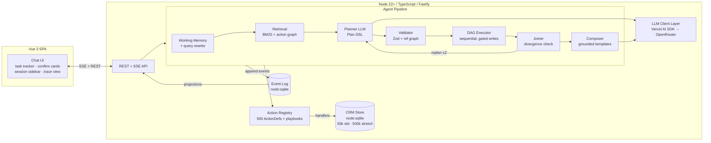

# Ask AI Framework — High-Level Design (HLD)

**Version:** 1.1 (post staff review) · **Date:** 2026-11-04 · **Status:** Review-fixed
**Companion docs:** [LLD.md](./LLD.md) · [Design spec](../superpowers/specs/2026-11-03-ask-ai-framework-design.md) · research reports in `../research/`

---

## 1. Purpose & Scope

A natural-language "Ask AI" agent over a simulated business platform with **50 modules ×
10 actions = 500 executable actions** (catalog fixed by the assignment PDF, M01 Contacts …
M50 Reports). Users chat (ChatGPT-style, persistent sessions); the agent understands direct,
indirect, multi-step, conditional, and follow-up requests; selects and executes the right
actions; streams live progress; and reports grounded results. Graded equally on **latency,
cost, and quality**, with a mandatory benchmark (≥100 scenarios, baseline vs optimized).

**Out of scope:** real third-party integrations, auth/multi-tenancy, production deployment
(see §9 Production Readiness).

## 2. Architecture Overview



**Core thesis:** the LLM is an untrusted planner; deterministic code owns execution. The
loop sits at *phase granularity* (plan → execute → observe → replan), not per-action: a
direct request costs 1 LLM call; a complex workflow 1–3, regardless of action count.

## 3. Component Responsibilities

| Component | Responsibility | Key decision |
|---|---|---|
| **Action Registry** | Loads 50 module files → 500 `ActionDef`s (Zod in/out schemas, risk class, search card, handler). Drop-in extensibility: new module file = registered, no core change. | Semantic IDs in outputs; JIT guidance inside results; token-capped responses |
| **Retrieval** | Deterministic shortlist: BM25 (fuzzy ON — typos are a brief requirement) over enriched cards + session-usage and module-cohesion boosts. Top ~20 cards as **text** in planner message. | No embeddings by default (probe-set gated); PPR graph cut post-review (deferred, in README); cache-safe (stable system prompt) |
| **Playbooks** | 3+ SKILL.md procedures (Agent Skills spec): name+description always visible (~100 tokens), body injected on match. Powers indirect requests. | Mirrors real product's "Skills" |
| **Planner** | One `generateObject` call → typed Plan DSL (steps, `$refs`, forEach/filter, conditions, `expects` assumptions) or clarify / unsupported / respond. | Model routed by complexity: flash-lite for simple, Haiku 4.5 default |
| **Validator** | Compile plan vs schemas + ref graph; ≤2 targeted repair calls. | Invalid plans never reach the executor |
| **Executor** | Topological stratum scheduler (sequential — node:sqlite is sync); writes gated per unified rule (risk ∈ {destructive,bulk,external} OR affectedCount>50; forEach gates once, aggregate). Confirmations bound to planHash+planRev+stepId; restart-safe resume via executor fold. Stuck detection ×3 hint / ×4 stop. | Code decides confirmations, never the model |
| **Joiner** | Checkpoint before every write-bearing stratum: results vs `expects`. Diverged → patch plan (≤2 rounds, bumps planRev) or ask user. | Kills plan-before-data failure mode (+10.3pts evidence) |
| **Composer** | Final answer from code templates over actual results. Streamed. (Polish pass cut post-review.) | Zero hallucination surface for outcomes |
| **Working Memory** | Single active task frame + entity map + result handles (idList/query + sample — not full rows; use-time existence re-check with drift reporting). Writes read IDs **only** from working state. Large results behind `$ref` handles. Observation masking of old tool results. | The follow-up engine; the hallucination firewall |
| **Event Log** | Append-only typed events; state = fold(events). Four projections: SSE stream, trace store, metrics, audit feed. | One write path; replay = live render |
| **LLM Client** | Vercel AI SDK (client layer only) → OpenRouter. Per-call `{model, tokens, cached, latency, costUsd}` via usage accounting. | Orchestration is ours; SDK's tool-loop reused as ReAct baseline |
| **CRM Store** | `node:sqlite`, indexed; `standard` (~50k, committed template, ms reset); `scale` 500k–1M stretch goal only (10M design documented, not run). | Reset speed is sacred for 660+ eval runs |

## 4. Primary Request Flow (sequence)

```mermaid
sequenceDiagram
  participant U as User
  participant API as API/SSE
  participant AG as Agent
  participant L as LLM (OpenRouter)
  participant S as CRM Store

  U->>API: POST message
  API->>AG: turn start (event: turn.started)
  AG->>AG: fold(events) → working memory; rewrite query
  AG->>AG: retrieve top-20 cards (+playbook)
  AG->>L: plan (generateObject, 1 call)
  L-->>AG: Plan DSL
  AG-->>U: SSE plan.ready ← FIRST USEFUL RESPONSE (~1.5s target)
  AG->>S: read steps (sequential, indexed)
  AG->>AG: joiner: results vs expects
  opt diverged (≤2)
    AG->>L: patch plan
  end
  opt destructive/bulk/external step
    AG-->>U: SSE confirmation.required (plan-hash bound)
    U->>API: confirm
  end
  AG->>S: write steps (sequential, idempotency keys)
  AG-->>U: SSE step.finished × N
  AG-->>U: SSE answer.delta (streamed composer)
  AG-->>U: SSE turn.completed {latency, tokens, cost}
```

## 5. Data Architecture

Two isolated persistence domains, one engine (`node:sqlite`):

1. **CRM domain** (resettable): ~22–25 merged entity tables (contacts, leads, invoices, …) with
   indexes; seeded deterministically; `standard` 50k (committed template) + `scale`
   500k–1M stretch; single reset = close→copy-template→reopen. Virtual clock pins "last week".
2. **Session domain** (durable): `sessions`, `events`, `refs` (cached result sets),
   `spans` (traces). Never touched by CRM resets. Session replay, resume, audit, and all
   benchmark numbers derive from here.

## 6. Latency / Cost / Quality Strategy

- **Latency:** stream `plan.ready` as the first useful response (TTFUR, not loading
  indicators); 1–3 LLM calls per turn by construction (node:sqlite is synchronous — reads
  run sequentially on indexed queries; no false parallelism claims); fast-path model
  routing; KV-cache-stable prompt prefix (append-only, sorted keys, timestamps outside
  prefix). Targets pre-committed in `docs/TARGETS.md` before benchmarking.
- **Cost:** shortlist (~20 cards) instead of 500 schemas; code-composed summaries (model
  never restates results); prompt caching; per-call cost from OpenRouter usage accounting;
  $25 benchmark spend ceiling enforced by the eval runner.
- **Quality:** validated structured plans; joiner replanning; provenance-gated writes;
  final-state assertions (not response-sounding-right); pass^1 **and pass^3** per category;
  abstention + missing-parameter + distractor cases.

## 7. Benchmark Design

- **Baseline:** AI SDK tool-loop ReAct with the full catalog summarized in context + one
  `call_action` dispatch tool (runnable on every model; avoids 128-tool caps), sharing
  harness (transcript, confirm gate, handlers). Baseline runs 1 trial (disclosed).
- **Optimized:** this architecture. Same ≥110 scenarios, 3 trials, state-based grading.
- **Matrix:** planner swapped across Haiku 4.5 / GPT-5-mini (minimal reasoning) /
  Gemini Flash on a ~40-scenario stratified subset.
- **Scale (stretch only):** 500k–1M profile, agent E2E flat-vs-50k, large bulk-confirm.
- **Smoke:** all 500 handlers auto-enumerated against seeded store.
- All numbers computed from the same trace store the demo shows.

## 8. Key Design Decisions & Rejected Alternatives

| Decision | Rejected | Why (evidence) |
|---|---|---|
| Plan-then-execute + joiner | ReAct core loop | 3.4–6.7× cost, 1.8–3.7× latency (LLMCompiler); ReAct kept as baseline |
| Deterministic lexical+graph retrieval | Embedding/LLM routers | goose deleted both; Anthropic's newest tool search is BM25; we author the cards |
| Plan DSL ("constrained code mode") | Code-execution sandbox | CodeAct wins are composition-only; write auditability + 5-day security burden (CE-MCP attacks) |
| Single agent (research sub-run README-only) | Multi-agent orchestration | ~15× tokens (Anthropic); CRM write dependencies |
| Working-state frames + $refs | Vector memory products | Unreproducible benchmark wars; follow-ups are a working-memory problem |
| Observation masking | LLM summarization condenser | JetBrains: masking ≥ summaries at −50% cost; cache-miss penalty |
| Hand-rolled orchestration + AI SDK client | LangGraph / Agents SDKs | Loop-owning frameworks invert our control model; graded on instrumentation transparency |

## 9. Production Readiness (honest line)

**Not prod:** mocked data, no auth/tenancy, single process, baseline security, no model ops.
**Prod-shaped:** event sourcing, idempotency, persist-before-ack, code-enforced gates,
span-level observability, CI-runnable eval flywheel. **Path:** store→real APIs/Postgres,
authn + role-scoped action visibility ("deny = schema not sent"), turn queue + stateless
workers, provider failover, evals as CI gate. Each is a swap, not a rewrite.

## 10. Risks

| Risk | Mitigation |
|---|---|
| Public solutions to same assignment exist | Scratch implementation; distinct DSL/naming; differentiators (model matrix, scale bench, working memory); never view their code |
| Provider latency tails via OpenRouter | Pin providers (`provider.order`); report conditions |
| 500 handlers in compressed schedule | Uniform store API + codegen + smoke-test safety net; parallel subagent implementation |
| Retrieval paraphrase misses | 60-query recall@20 probe gate; embeddings as contingency |
| Benchmark overspend | $25 ceiling with abort-and-report-partial |
